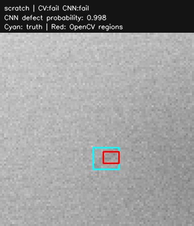
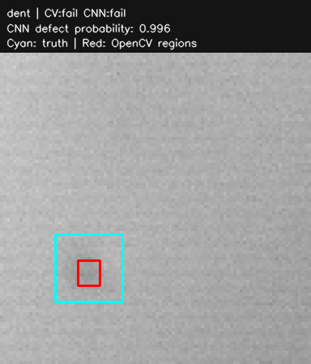
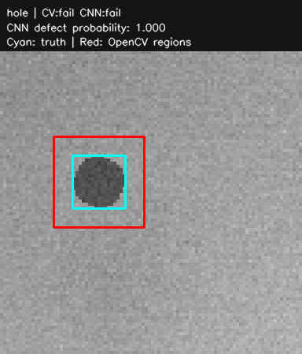

# Synthetic inspection evaluation

All images are code-generated grayscale metal-like textures. No real camera, machine, cloud, GPU, or live MQTT broker was used.

Source: [GitHub Actions CPU run](https://github.com/hamza2829/camera-quality-inspection/actions/runs/41340065785), commit `da9e7fdd26c736f3b4db880549d8d17b685d3a1e`. This report was generated by that run.

Seed: `20261101`. Split sizes: {'train': 600, 'validation': 180, 'test': 180}. Each split is 50% clean and 1/6 each scratch/dent/hole. One simulated defect per defective image. The always-fail baseline has precision 0.5 and recall 1.0.

## Held-out image-level results

Positive means defective/fail. Matrices have actual rows [clean, defective] and predicted columns [pass, fail]: `[[TN, FP], [FN, TP]]`. Zero-denominator precision/recall is defined as 0.

| Method | Precision | Recall | F1 | Accuracy | Confusion matrix |
| --- | ---: | ---: | ---: | ---: | --- |
| opencv | 1.0000 | 0.5778 | 0.7324 | 0.7889 | `[[90, 0], [38, 52]]` |
| cnn | 1.0000 | 0.8000 | 0.8889 | 0.9000 | `[[90, 0], [18, 72]]` |

## Observed errors

Counts below come from the held-out predictions, not assumptions about either method.

| Ground-truth type | Test images | OpenCV errors | CNN errors |
| --- | ---: | ---: | ---: |
| none | 90 | 0 | 0 |
| scratch | 30 | 11 | 9 |
| dent | 30 | 27 | 9 |
| hole | 30 | 0 | 0 |

For clean images an error is a false alarm; for each defect type it is a missed defect. OpenCV removes low-frequency illumination, which can also remove shallow dents; median filtering and morphological opening can erase thin scratches. The CNN produces an image-level score and cannot locate or identify defect types. Its error counts above show the limits of this short training run.

## Protocol and limitations

- OpenCV was selected from 12 threshold/min-area combinations using validation F1: `{'threshold': 8, 'min_area': 10}`.
- CNN: 10 CPU epochs, 17409 parameters, no pretrained weights. Checkpoint epoch 7 had lowest validation BCE; threshold 0.35 maximized validation F1 over 0.10..0.90 in 0.05 increments.
- Both methods see the same held-out test images. Test labels are used only for reporting, never fitting or threshold selection. Results describe one fixed split and seed; there are no multi-seed uncertainty estimates or real-world generalization claims.
- CNN inputs are denoised intensity and absolute local-background residual. Contour boxes/areas come exclusively from OpenCV. These are image-level classification metrics, not detection AP/IoU or calibrated physical measurements.
- Measured training time: 7.53 seconds (runner-dependent; excludes installation/generation/evaluation). Device: CPU, two PyTorch threads. Software: `{'numpy': '2.2.6', 'opencv-python-headless': '4.12.0.88', 'torch': '2.7.1+cpu', 'paho-mqtt': '2.1.0', 'pydantic': '2.11.7'}`; OS `Linux-7.0.0-1017-azure-x86_64-with-glibc2.39`.
- Mock pipeline: 360 JSON publishes including replay; 180 inserted rows, 180 duplicate replays, 180 stored rows. No MQTT network or cloud boundary was exercised.
- Final pipeline decision is conservative OR (fail if either method fails). Only the two individual methods are benchmarked above; no quality claim is made for the combined rule.
- SHA-256 of labels.csv: `408a456412ad255e32ae877a072106bb7c710c3977596170b101e0de07bee5cf`. Predictions, labels, generated images, training losses, checkpoint, SQLite database, and machine-readable metrics are available in the run artifact.

## Three held-out examples

One example per defect type. Select the first OpenCV detection of each type to show actual found regions; if none exists, show the first image and its miss. This is a deliberately selected illustration, not a representative sample or a metric calculation. The error table above includes every test image. Cyan boxes are generator ground truth; red boxes are actual OpenCV regions. CNN is classification-only and has no boxes.

### scratch: `sim-80f6677488e03cdf9201e7a5`

OpenCV **fail**; CNN **fail**. See predictions.json for exact probabilities/regions.

### dent: `sim-28aec3a2eb1394b4339f1719`

OpenCV **fail**; CNN **fail**. See predictions.json for exact probabilities/regions.

### hole: `sim-59327a92890cbcfa3ee83444`

OpenCV **fail**; CNN **fail**. See predictions.json for exact probabilities/regions.

