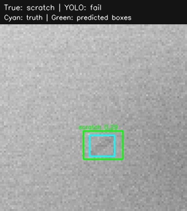
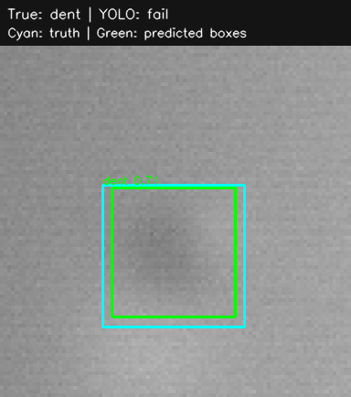
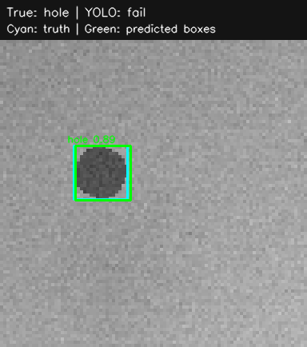

# CPU YOLO and C++ extension evaluation

Synthetic fine-tuning/evaluation images only. No factory data, camera, GPU, live MQTT broker, or deployed cloud service.

Source: [actual CI run](https://github.com/hamza2829/camera-quality-inspection/actions/runs/41341879887) at `9f08c31be0328396f3b233efe0bc4c6391f5b296`.

Seed 20261101; unchanged 600/180/180 splits. labels.csv SHA-256: `408a456412ad255e32ae877a072106bb7c710c3977596170b101e0de07bee5cf`. Test: 90 clean frames plus 30 each scratch/dent/hole.

## Methods on the same 180 test images

Image P/R use any detected defect as positive, without checking location/type. Detection mAP50 is class-aware AP averaged over scratch/dent/hole. N/A means the method does not output class-scored detections; classification F1 is not mAP. Overlap counts below are class-agnostic at IoU >= 0.5, with unique matched truths shown separately.

| Method | Image precision | Image recall | Detection mAP50 | Overlapping boxes / predicted boxes | Matched truths / 90 |
| --- | ---: | ---: | ---: | --- | --- |
| opencv | 1.0000 | 0.5778 | N/A | 17 / 52 | 17 / 90 |
| cnn | 1.0000 | 0.7667 | N/A | N/A | N/A |
| yolo | 1.0000 | 0.8333 | 0.8738 | 74 / 77 | 72 / 90 |
| cpp_stage | 1.0000 | 0.6111 | N/A | 16 / 56 | 16 / 90 |

CNN is classification-only. OpenCV is the unchanged full inspector. C++ is a preprocessing/connected-component stage with no morphology; it is not a replacement for the complete original inspector.

## Image confusion matrices

From the same run's machine-readable metrics; actual rows `[clean, defective]`,
predicted columns `[pass, fail]`, i.e. `[[TN, FP], [FN, TP]]`:

| Method | Matrix |
| --- | --- |
| OpenCV | `[[90, 0], [38, 52]]` |
| CNN, retrained | `[[90, 0], [21, 69]]` |
| YOLOv8n, any box | `[[90, 0], [15, 75]]` |
| C++ stage, any component | `[[90, 0], [35, 55]]` |

## Per-defect performance

OpenCV/CNN columns are image-level binary recall within each true-type subgroup. YOLO image recall is also location/type agnostic. YOLO detection P/R require the correct class AND IoU >= 0.5, at a confidence fixed to 0.25 before test evaluation. AP50 sweeps confidence using Ultralytics validation at conf=0.001. We do not report the library's test-selected best-F1 precision/recall.

| True defect | OpenCV image recall | CNN image recall | YOLO image recall | YOLO detection precision | YOLO detection recall | AP50 | TP / FP / FN |
| --- | ---: | ---: | ---: | ---: | ---: | ---: | --- |
| scratch | 0.6333 | 0.7000 | 0.9000 | 0.8889 | 0.8000 | 0.8538 | 24 / 3 / 6 |
| dent | 0.1000 | 0.6000 | 0.6000 | 0.9000 | 0.6000 | 0.7725 | 18 / 2 / 12 |
| hole | 1.0000 | 1.0000 | 1.0000 | 1.0000 | 1.0000 | 0.9950 | 30 / 0 / 0 |

Lower YOLO subgroup image recall than a baseline is a direct pass/fail disadvantage. Class-aware detection recall is a stricter task; it must not be presented as the same quantity as a classifier's recall.

- scratch: YOLO image recall 0.9000; not below either baseline's subgroup image recall in this run.

- dent: YOLO image recall 0.6000; not below either baseline's subgroup image recall in this run.

- hole: YOLO image recall 1.0000; not below either baseline's subgroup image recall in this run.

## Historical baseline comparison (documentation annotation)

The original [CI snapshot](https://github.com/hamza2829/camera-quality-inspection/actions/runs/41340065785)
reported CNN overall recall 0.8000 and dent image recall 0.7000. YOLO dent image
recall in this extension run is **0.6000, worse than that existing CNN result**.
The CNN freshly retrained in this extension run scored 0.7667 overall and 0.6000
on dents, tying YOLO on that subgroup. The earlier snapshot is preserved in
[evaluation.md](evaluation.md) and [metrics.json](metrics.json). The image/CSV hash
is unchanged; training/validation outcomes can vary across builds and hardware.
This annotation was added when checking in the downloaded CI report; all measured
extension values and example images above/below come from the cited extension run.

## Training provenance and limits

YOLOv8n initialization: **coco_pretrained**. 5 epochs, 96-pixel input, CPU, frozen backbone layers: 10. Training time including per-epoch validation/final checkpoint validation: **26.92 s**. Confidence 0.25, NMS IoU 0.7, max 100 predictions/image; no test-driven tuning.

COCO-pretrained initialization uses external pretrained weights learned from COCO, not weights learned only from synthetic images. All fine-tuning and reported evaluation images are synthetic. If the official weight download fails, the code constructs the architecture from YAML and trains all layers from scratch instead, recording the error.

Download outcome: `None`. Initial weight hash: `f59b3d833e2ff32e194b5bb8e08d211dc7c5bdf144b90d2c8412c47ccfc83b36`. Evaluated checkpoint hash: `ba299a49a130ad43d1fe662a4bdf2031bd651639d71fb51b7cbd52dd23f8fc4e`.

Software: `{'numpy': '2.2.6', 'opencv-python': '4.12.0.88', 'torch': '2.7.1+cpu', 'torchvision': '0.22.1+cpu', 'ultralytics': '8.3.169'}`. Hardware/OS: `Linux-7.0.0-1017-azure-x86_64-with-glibc2.39`. One seed/split only, uncalibrated scores, no production accuracy or real-time claim.

## C++ parity and timing

C++17 has no OpenCV dependency. It implements replicated-border median 3x3, separable double-precision Gaussian 31x31 sigma=5 with REFLECT_101, absolute residual >8, and handwritten eight-connected BFS with >=10 foreground pixels/component. The Python stage reference uses OpenCV with these exact settings, before morphology. The original inspector keeps its uint8 Gaussian, morphology, contour-area filtering, and centroid logic.

Across 180 test images: 0 differing mask pixels; 0 images with stage boxes differing by more than one pixel. Compared with the original full inspector, 37 images have different boxes (different stages/area semantics, not an equivalence claim). Per-image differences are in metrics.json.

Both references run one thread. Inputs are preloaded and PGM writes are outside the timing. Kernel timings average three repeats/image; OpenCV is warmed up. C++ CLI end-to-end timing uses a separate single-image process including PGM read, compute, full-mask JSON output and Python JSON parsing. It is not divided by the repeat count.

| Implementation / boundary | Mean ms per image |
| --- | ---: |
| Python/OpenCV stage in process | 0.2931 |
| C++ compute only (Release) | 1.5272 |
| C++ subprocess, input/output and parse | 4.6454 |

This small C++ implementation is not optimized. No speedup is assumed; process/serialization overhead and different code paths are shown explicitly. Timings are runner-specific, not a latency SLA.

## Pipeline replay

Schema/topic v2 publishes actual YOLO boxes plus confidence/class/weight provenance. Validated SQLite table inspections_v2 keeps boxes as explicit JSON and inside the canonical payload. 180 inserted rows; 180 duplicate replays; 360 mock publishes. v1 payloads are rejected; old v1 tables are not altered. No MQTT network/cloud boundary was tested.

## Marked test examples

For each true type, choose the first image with a YOLO prediction, otherwise its first image (showing a miss). Cyan is truth, green is actual predicted class/confidence/box. These are selected illustrations; every test image contributes to metrics.

### scratch: `sim-80f6677488e03cdf9201e7a5` (1 predicted boxes)

### dent: `sim-b9168bcc08f8ccc270dcde11` (1 predicted boxes)

### hole: `sim-59327a92890cbcfa3ee83444` (1 predicted boxes)

